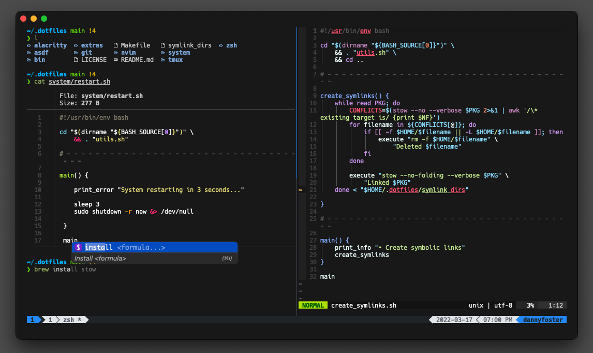

# dotfiles

[](https://www.apple.com/macos)

Automated macOS setup: Homebrew packages from a `Brewfile`, language runtimes from [mise](https://mise.jdx.dev), symlinked shell and Git config, and system preferences. Works on Apple Silicon and on Intel Macs running macOS 13 or later.

⚠️ **Warning:** This is catered to my own use. Fork it, review [`system/setup.sh`](system/setup.sh) and the [`Brewfile`](Brewfile), and adjust before running it.

<h2 id="setup">🔧 Setup</h2>

<h3 id="requirements">✅ Requirements</h3>

Update macOS and install the Xcode Command Line Tools. On Apple Silicon, Rosetta 2 is only needed for apps that still ship Intel-only builds.

```bash
sudo softwareupdate -i -a
xcode-select --install

# Apple Silicon, optional
sudo softwareupdate --install-rosetta --agree-to-license
```

<h3 id="installation">🚀 Installation</h3>

```bash
git clone https://github.com/dxnter/dotfiles.git ~/.dotfiles
cd ~/.dotfiles
make
```

`make` sets the hostname, installs Homebrew and everything in the `Brewfile`, sets Homebrew's zsh as the login shell with oh-my-zsh, links the config files, installs mise and its runtimes and tools, applies system preferences, and restarts.

Existing files that would block a symlink are moved into `~/.dotfiles/backup/` rather than overwritten. To copy the current versions there before running anything, use `make backup`.

After the restart, generate an SSH key and a GPG signing key for GitHub. Each script copies the public key to the clipboard and opens the matching GitHub settings page.

```bash
make ssh
make gpg
```

<h3 id="targets">💡 Make targets</h3>

| Target        | What it does                                              |
| ------------- | --------------------------------------------------------- |
| `make`        | Full setup                                                |
| `make brew`   | Install or update everything in the `Brewfile`            |
| `make mise`   | Install the runtimes in `~/.config/mise/config.toml`      |
| `make links`  | Symlink every package listed in `symlink_dirs`            |
| `make unlink` | Remove those symlinks                                     |
| `make prefs`  | Apply macOS preferences only                              |
| `make backup` | Copy current dotfiles into `backup/`                      |
| `make ssh`    | Generate an ed25519 key for GitHub                        |
| `make gpg`    | Generate a GPG key and set it as the Git signing key      |

<h2 id="software">💾 Software</h2>

**Homebrew** installs CLI tools, apps and fonts from the [`Brewfile`](Brewfile). Every Mac gets the same apps. When a current cask needs a newer macOS than the Mac has, the Brewfile installs a pinned cask from [`Casks/`](Casks) instead: OrbStack 1.11.3 and ProtonVPN 5.1.0 on macOS 13. On those Macs the repo is tapped locally as `dxnter/dotfiles`. Add a package with `brew "name"` or `cask "name"` and run `make brew`. Search with the [package browser](https://formulae.brew.sh/).

**mise** installs language runtimes and most CLI tools from [`mise/.config/mise/config.toml`](mise/.config/mise/config.toml): Node (LTS), pnpm, Bun, Python, uv, Rust, Go, plus tools like `bat`, `fd`, `ripgrep`, `gh`, `neovim`, `pandoc`, `ffmpeg` and `starship`. They're prebuilt binaries, so they install quickly on Intel Macs too, where Homebrew no longer publishes bottles. On macOS 13 and older, `.zshenv` sets `MISE_ENV=legacy`, which layers [`config.legacy.toml`](mise/.config/mise/config.legacy.toml) on top to pin the few tools whose newest builds need a newer macOS. mise itself comes from its official installer. The global config tracks `lts`/`latest`; projects pin their own versions in `mise.toml` or `.tool-versions`. Update everything with `mise upgrade`.

**Herd** provides PHP, Composer and the local Laravel services. mise does not manage PHP.

Node comes from mise even though Herd installs its own nvm: `.zprofile` puts mise's shims on `PATH` for GUI apps and scripts, and `.zshrc` runs `mise activate` last, so mise wins over the nvm lines Herd adds to `~/.zshrc`.

<h2 id="customize">🎨 Customize</h2>

The zsh config is split by when zsh reads it:

- `zsh/.config/zsh/.zshenv` → Environment variables read by every shell (no `PATH`, no commands, no secrets)
- `zsh/.config/zsh/.zprofile` → `PATH`, built once per login shell; each entry is added only if the directory exists
- `zsh/.config/zsh/.zshrc` → Interactive setup: oh-my-zsh, history, Starship, mise
- `zsh/.config/zsh/.aliases` and `.functions` → Aliases and functions

**Note:** `~/.zshrc` and `~/.zprofile` are not read by zsh here because `ZDOTDIR` is `~/.config/zsh`. Installers still append to them, so the `ZDOTDIR` files source both at the end. Keep your own settings in the local files below.

<h4 id="zshrclocal">`~/.zshrc.local`</h4>

Sourced after the aliases and functions, for machine-specific aliases and shell settings that stay out of version control.

<h4 id="zshenvlocal">`~/.zshenv.local`</h4>

Sourced at the end of `.zshenv` by every shell. Use it for machine-specific environment and for secrets, read from the login keychain rather than written in plain text:

```shell
export TF_VAR_local_state_passphrase="$(security find-generic-password -s tf-state-passphrase -w 2>/dev/null)"
```

Store a value with `security add-generic-password -a "$USER" -s <service> -w '<value>' -U`.

<h4 id="gitconfiglocal">`~/.gitconfig.local`</h4>

Included after `~/.gitconfig`. Keep the Git identity and signing key here:

```ini
[user]
    name = John Doe
    email = jdoe@example.com
    signingKey = XXXXXXXX
```

<h2 id="adding-dotfiles">⏫ Adding Dotfiles</h2>

[GNU Stow](https://www.gnu.org/software/stow/) links each top-level package directory into `$HOME`. The contents of a package mirror their path relative to `$HOME`:

```
mise
└── .config
    └── mise
        └── config.toml
```

Add the package name to `symlink_dirs`, then link it:

```bash
echo 'mise' >> symlink_dirs
make links
```

<h2 id="system-prefs">⚙️ System Preferences</h2>

The full setup applies the preferences in [`system/preferences`](system/preferences). To apply them on their own:

```bash
make prefs
```

<h2 id="acknowledgments">👏 Acknowledgments</h2>

- [alrra/dotfiles](https://github.com/alrra/dotfiles)
- [webpro/dotfiles](https://github.com/webpro/dotfiles)

<h2 id="license">📝 License</h2>

Usage is provided under the [MIT License](LICENSE).
